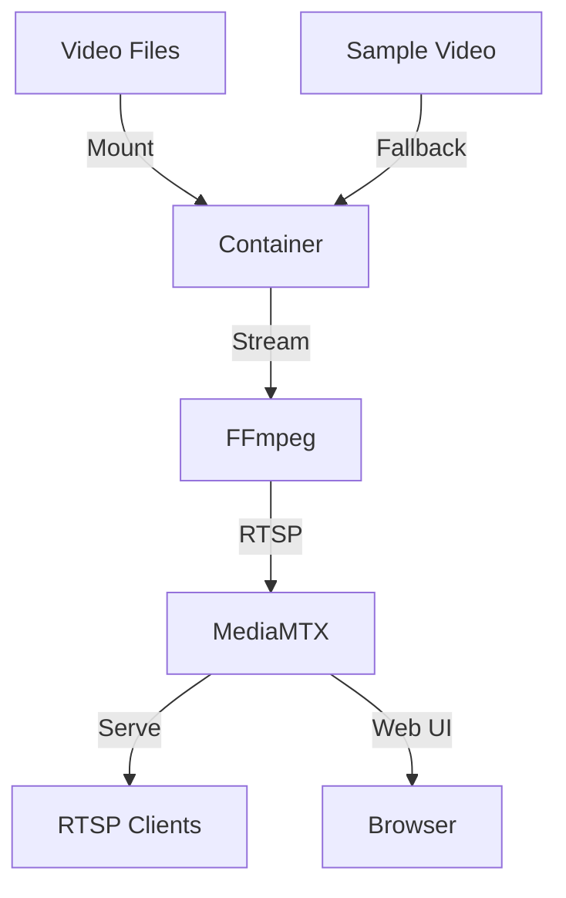

# RTSP Video Streamer Documentation

## Overview

The RTSP Video Streamer is a Docker-based solution for streaming videos via the RTSP protocol. It combines MediaMTX (RTSP server) and FFmpeg (video streaming) into a single container, providing a simple and efficient way to stream videos over RTSP. The solution includes a default sample video that will be used if no videos are provided by the user.

## Architecture

### Components

1. **MediaMTX (RTSP Server)**
   - Handles RTSP protocol
   - Manages multiple streams
   - Provides web interface for monitoring
   - Runs on port 8554 (RTSP) and 8888 (Web UI)

2. **FFmpeg (Video Streamer)**
   - Handles video streaming
   - Supports multiple video formats
   - Configurable loop mode
   - Streams to local MediaMTX server

3. **Container Structure**
   ```
   [Container]
   ├── MediaMTX Server
   ├── FFmpeg Streamer
   ├── Shared Volume (/data/videos)
   └── Sample Videos (/usr/local/share/sample-videos)
   ```

### Flow Diagram



## Project Structure

```
rtsp-streamer/
├── .github/
│   └── workflows/
│       ├── ci.yaml           # CI workflow configuration
│       └── release.yaml      # Release workflow configuration
├── Dockerfile              # Multi-stage build configuration
├── docker-compose.yml      # Main compose configuration
├── docker-compose.reference.yml  # Reference two-container setup
├── docker-entrypoint.sh    # Container startup script
├── stream.sh              # Video streaming script
├── .env                   # Environment configuration
├── Makefile              # Build automation
├── sample-videos/        # Directory containing sample videos
│   └── sample-video.mp4  # Default sample video
└── docs/
    └── README.md         # This documentation
```

## CI/CD Pipeline

### Continuous Integration

The CI workflow (`ci.yaml`) runs on:
- Every push to main branch
- Pull requests to main branch
- Version tag pushes
- Manual triggers

CI Process:
1. Builds Docker image without cache
2. Runs comprehensive tests:
   - Container health check
   - RTSP port accessibility
   - Web interface accessibility
   - Video source mounting
3. Publishes Docker image on version tags

### Release Process

The release workflow (`release.yaml`) handles version management:
- Supports semantic versioning (major.minor.patch)
- Creates GitHub releases
- Triggers Docker image publishing

Release Types:
- **Major**: Breaking changes
- **Minor**: New features
- **Patch**: Bug fixes

### Docker Image Publishing

Images are published to Plainsight's container registry:
- Tagged with version number
- Includes latest tag for most recent version
- Built with BuildKit for optimization

## Configuration

### Environment Variables

The project is configured through environment variables in `.env`:

```env
# RTSP Server Configuration
RTSP_PORT=8554
RTSP_TRANSPORT=tcp
WEB_INTERFACE_PORT=8888

# Video Configuration
VIDEO_SOURCE=/data/videos
VIDEO_LOOP=false
VIDEO_STREAM_NAME=mystream

# Resource Limits
FFMPEG_CPU_LIMIT=1000m
FFMPEG_MEMORY_LIMIT=1Gi
FFMPEG_CPU_REQUEST=500m
FFMPEG_MEMORY_REQUEST=512Mi
RTSP_CPU_LIMIT=500m
RTSP_MEMORY_LIMIT=512Mi
RTSP_CPU_REQUEST=200m
RTSP_MEMORY_REQUEST=256Mi
```

### Build Configuration

The project uses a multi-stage Dockerfile to create an optimized image:

1. **Stage 1**: RTSP Server (MediaMTX)
2. **Stage 2**: FFmpeg
3. **Stage 3**: Final Alpine-based image
   - Includes sample video
   - Sets up necessary directories
   - Configures environment

## Usage

### Building

```bash
# Build the image
make build

# Build without cache (CI)
make build-no-cache
```

### Running

```bash
# Run in foreground
make run

# Run in background
make run-detached

# Stop containers
make stop
```

### Testing

```bash
# Run basic tests
make test

# Test stream with FFmpeg
ffplay rtsp://localhost:${RTSP_PORT}/${VIDEO_STREAM_NAME}
```

## Features

1. **Video Support**
   - Multiple video formats (MP4, AVI, MKV)
   - Single or multiple video streaming
   - Configurable loop mode
   - Default sample video when no videos provided

2. **Streaming Options**
   - TCP transport for reliability
   - Configurable stream names
   - Parallel multiple streams
   - Automatic fallback to sample video

3. **Monitoring**
   - Web interface for stream management
   - Health checks
   - Resource monitoring

4. **Resource Management**
   - Configurable CPU limits
   - Memory limits
   - Resource reservations

## Development

### Adding New Features

1. **New Video Format**
   - Add format to `stream.sh`
   - Update documentation
   - Add tests in CI workflow

2. **New Configuration**
   - Add to `.env`
   - Update Dockerfile if needed
   - Document changes
   - Update CI tests

3. **Sample Video**
   - Place new sample videos in `sample-videos/` directory
   - Update Dockerfile to copy new samples
   - Update stream script if needed

### Testing

1. **Local Testing**
   ```bash
   make test
   ```

2. **Manual Testing**
   ```bash
   # Start service
   make run-detached
   
   # Check logs
   docker-compose logs -f
   
   # Test stream
   ffplay rtsp://localhost:8554/mystream
   ```

3. **Testing with Sample Video**
   ```bash
   # Start without mounting videos
   docker-compose up
   
   # Test sample stream
   ffplay rtsp://localhost:8554/mystream
   ```

## Troubleshooting

### Common Issues

1. **Stream Not Starting**
   - Check video files in mounted directory
   - Verify RTSP server is running
   - Check container logs
   - Verify sample video is present

2. **Connection Issues**
   - Verify port mappings
   - Check firewall settings
   - Test with FFmpeg directly

### Logs

```bash
# View container logs
docker-compose logs -f

# View specific service logs
docker-compose logs -f rtsp-streamer
```